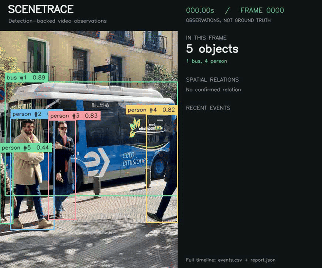

# SceneTrace

**Turn object detections into a reviewable timeline of what a video appears to show.**

SceneTrace detects objects in an image or recorded video, labels them, assigns lightweight track IDs, and logs persistent observations: first detections, missing detections, and changes in left/right spatial relationships. Every event links to an annotated evidence frame.



*Controlled demo: a translated example photo, a blank interval, and restored detections. [Full-resolution image output](examples/image_result/preview.jpg).*

## Why this project

This independent project is inspired by my experience with video data quality checks and qualitative model evaluation at an AI video-reasoning startup. That work made the connection between a visual claim and its supporting evidence especially relevant to me.

SceneTrace explores a small part of that problem: instead of stopping at bounding boxes, it turns detections into explicit observations that a person can inspect against the original frames. It uses a public pretrained model and a public example image; it contains no company code, data, or internal evaluation system.

**Example:** a reviewer can find the time when an object was no longer detected, open the exact evidence frame, and decide whether this reflects occlusion, a missed detection, or an actual scene change. The program does not make that final judgment automatically.

## What it does

- Detects common objects with **pretrained YOLOv8n**, including people, vehicles, and everyday items. The included example focuses on people and a bus; `--classes` selects other supported categories.
- Draws bounding boxes, labels, confidence scores, track IDs, and per-frame counts.
- Associates detections across analyzed frames using class labels, box overlap, and center distance.
- Confirms observations over consecutive frames to reduce one-frame noise.
- Records `first_detected`, `no_longer_detected`, `relation_observed`, and `relation_changed` events.
- Saves evidence images, an annotated video/image, a CSV event timeline, and a JSON report with per-frame detections.
- Handles empty images and video intervals without detections.

The custom contribution is the **temporal event logic, spatial relationship analysis, and evidence export**, implemented separately from the detector in [`scenetrace/logic.py`](scenetrace/logic.py).

## Install

Python **3.12** is recommended. Tested on macOS with Apple Silicon, using CPU inference. No API key or paid service is needed. Run these commands from the repository directory:

```bash
python3 -m venv .venv
source .venv/bin/activate
python -m pip install -r requirements.txt
```

On Windows, activate with `.venv\Scripts\activate` instead. The first run downloads the approximately 6 MB `yolov8n.pt` weights from Ultralytics; subsequent runs reuse the local file. Installing PyTorch and other dependencies also needs internet access. [`requirements-lock.txt`](requirements-lock.txt) records the exact environment used for the included results; `requirements.txt` is the normal installation entry point.

## Run

### Included image

```bash
python -m scenetrace examples/street.jpg --classes person,bus --output outputs/street
```

### Included 8-second controlled video

```bash
python -m scenetrace examples/controlled_clip.mp4 --classes person,bus --stride 2 --output outputs/video
```

### Your own video

```bash
python -m scenetrace path/to/video.mp4 --classes cup,bottle --output outputs/my-video
```

Omit `--classes` to detect any of the model's supported categories. Use exact labels such as `cell phone` or `potted plant`, quoting the argument if it contains spaces. Inputs are local image/video files; webcam capture is outside this version's scope.

### Empty-input demonstration

```bash
python -m scenetrace examples/empty.png --output outputs/empty
```

Outputs must go to a **new or empty directory** to avoid overwriting a previous run. Choose another `--output` path when rerunning. See all options with `python -m scenetrace --help`.

## Inspect the results

| File | Purpose |
| --- | --- |
| `annotated.jpg` or `annotated.mp4` | Detection overlay, counts, relations, and recent events |
| `preview.jpg` | Quick visual preview |
| `SUMMARY.md` | Human-readable timeline with evidence links |
| `events.csv` | One row per event, with timestamp, track IDs, and evidence path |
| `report.json` | Settings, per-frame boxes/confidence/counts, and event records |
| `evidence/frame_*.jpg` | Annotated frames supporting the events |

Checked-in results: [image](examples/image_result/SUMMARY.md), [video timeline](examples/video_result/SUMMARY.md), [annotated video](examples/video_result/annotated.mp4), and [empty image](examples/empty_result/SUMMARY.md).

## How the pipeline works

1. Open the input with OpenCV. For video, analyze every `--stride` frames and derive timestamps from the original frame index and frame rate.
2. Run YOLOv8n; keep predictions above `--conf` (default 0.35), optionally filtered by class. At most 12 detections are retained per analyzed frame to keep pairwise review manageable.
3. Match detections to tracks of the same class. Candidates need IoU of at least 0.1 or center distance within 0.12 in image-normalized coordinates. A greedy one-to-one match prefers overlap and proximity. This is a simple tracker, not a re-identification model.
4. Confirm first detections after two consecutive analyzed frames by default. Log a missing detection only after three missed analyzed frames. A short dropout preserves the existing ID; an expired track gets a new ID if detected later.
5. Compare horizontal box centers. A separation within 6% of the image width is `aligned`; otherwise the relationship is `left_of` or `right_of`. A relationship must persist for two analyzed frames before it is logged. Image inputs use one-frame confirmation.
6. Export the observations and the exact annotated frames where they were confirmed. Event timestamps describe **confirmation time**, not an estimated true onset.

For a 10 FPS clip with `--stride 2`, the analyzed interval is 0.2 seconds. The annotated output runs at 5 FPS so its duration approximately matches the input. Left/right means position in the image, not depth, physical contact, or world coordinates.

**Why YOLOv8n?** A small pretrained detector keeps CPU inference practical and lets this project focus on interpretable downstream behavior. Training a new model would require labeled data and additional evaluation without directly solving the event-review problem. See the [Ultralytics prediction API](https://docs.ultralytics.com/modes/predict/) and [COCO class documentation](https://docs.ultralytics.com/datasets/detect/coco/).

## Validation

The included real-image run detected **one bus and three people** at the configured threshold. The 8-second controlled clip produced **40 analyzed frames**, including **10 empty frames**, and **36 events**. These are observed outputs, not accuracy scores. Counts can differ across model/runtime versions and inference settings.

The video is deliberately an **edited still-image test**: original photo, translated photo, blank interval, then restored photo. It validates video I/O, event persistence, missing-detection handling, recovery, and evidence export. It does **not** establish performance on natural motion. Its construction is fully available in [`scripts/make_demo.py`](scripts/make_demo.py); run `python scripts/make_demo.py` to recreate the inputs.

```bash
python -m pip install -r requirements-dev.txt
python -m pytest -q
python scripts/verify_examples.py
```

Tests cover empty detections, transient false positives, dropout tolerance, track identity, persistent relationship changes, and degenerate boxes. The example checker verifies the saved inference artifacts and video frame count. Synthetic box tests check event logic separately from model quality.

## Limitations and next steps

- Detector errors propagate to the timeline. **Not detected** does not mean an object physically disappeared; the included clip exposes intermittent detections of a partially visible person.
- Track IDs can switch when similar objects cross, move quickly, or are occluded. A stronger tracker and manually annotated natural videos would be the next evaluation step.
- Left/right is calculated from box centers. Overlapping or large boxes can yield relationships that do not match a person's semantic description.
- Thresholds and frame sampling trade responsiveness for stability. Brief events between sampled frames can be missed.
- This is a transparent rule-based observation tool, not a general video reasoning model, a generated-video quality score, or a validated research benchmark.
- Reports retain per-frame metadata in memory, so this version is intended for short clips. Natural-motion evaluation, streaming report writes, richer relations, and uncertainty visualization are future improvements.

## Source and license

Project source is available under [AGPL-3.0](LICENSE). Ultralytics is an external dependency under its upstream licensing terms. The example photo is the `bus.jpg` asset distributed with [Ultralytics v8.3.221](https://github.com/ultralytics/ultralytics/blob/v8.3.221/ultralytics/assets/bus.jpg); the input clip and result images are derived from that photo. See [THIRD_PARTY.md](THIRD_PARTY.md) for provenance. Model weights are downloaded on first use and are excluded from this repository.
