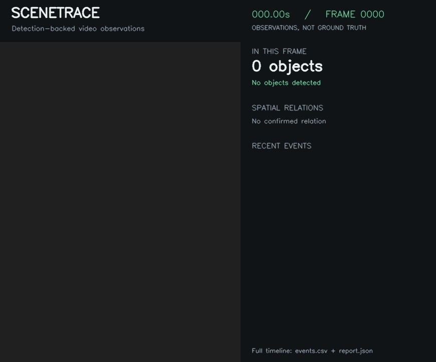

# SceneTrace run

Input: `empty.png`

Analyzed **1 frames**, including **1 without detections**; logged **0 events**.

## Event timeline

No confirmed events. See report.json for per-frame detections.

Events reflect model observations, not verified scene changes. End of file does not imply that visible objects disappeared.
