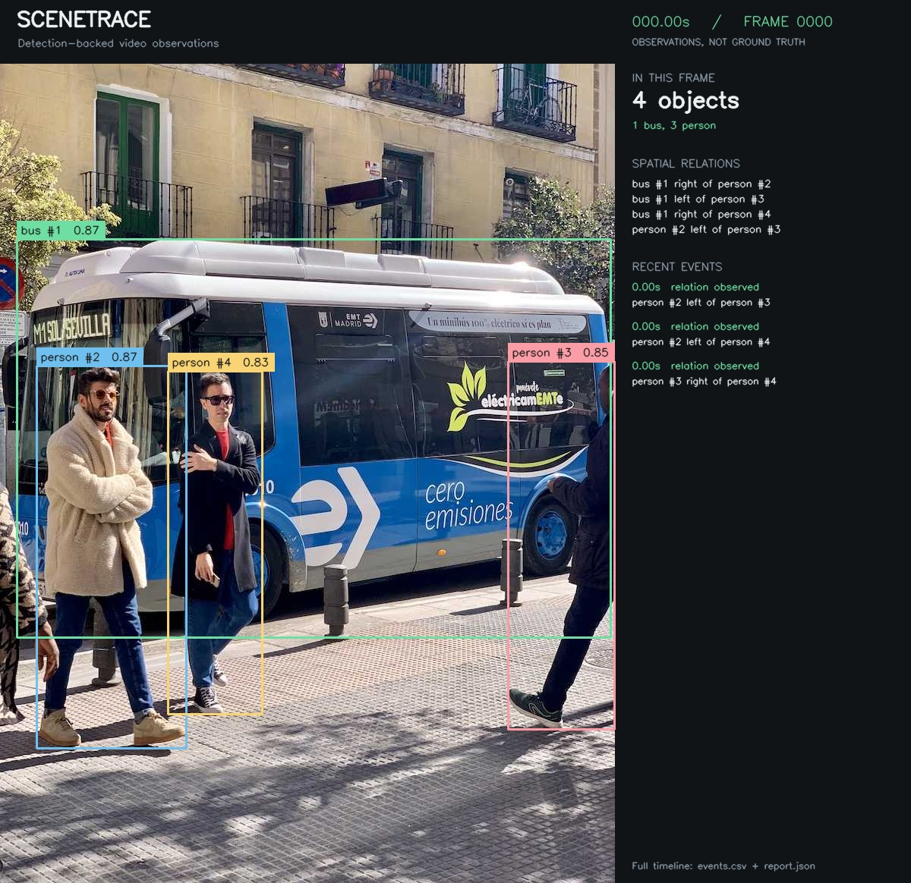

# SceneTrace run

Input: `street.jpg`

Analyzed **1 frames**, including **0 without detections**; logged **10 events**.

## Event timeline

- **0.00s** — bus #1: detection confirmed ([evidence](evidence/frame_000000.jpg))
- **0.00s** — person #2: detection confirmed ([evidence](evidence/frame_000000.jpg))
- **0.00s** — person #3: detection confirmed ([evidence](evidence/frame_000000.jpg))
- **0.00s** — person #4: detection confirmed ([evidence](evidence/frame_000000.jpg))
- **0.00s** — bus #1 right of person #2 ([evidence](evidence/frame_000000.jpg))
- **0.00s** — bus #1 left of person #3 ([evidence](evidence/frame_000000.jpg))
- **0.00s** — bus #1 right of person #4 ([evidence](evidence/frame_000000.jpg))
- **0.00s** — person #2 left of person #3 ([evidence](evidence/frame_000000.jpg))
- **0.00s** — person #2 left of person #4 ([evidence](evidence/frame_000000.jpg))
- **0.00s** — person #3 right of person #4 ([evidence](evidence/frame_000000.jpg))

Events reflect model observations, not verified scene changes. End of file does not imply that visible objects disappeared.
