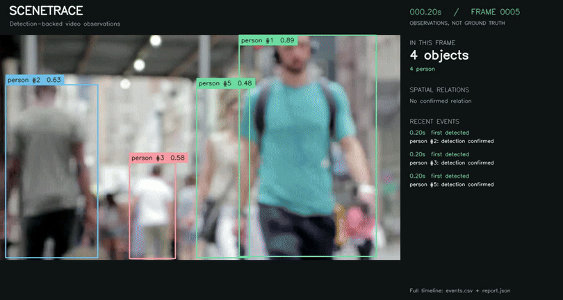
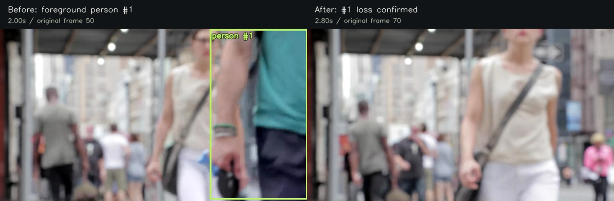
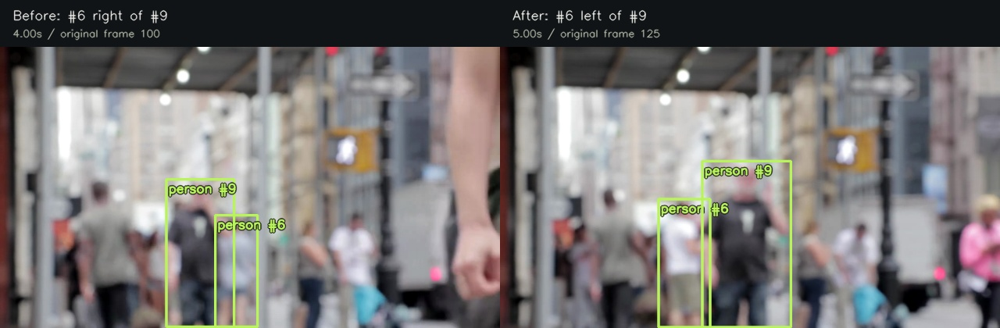
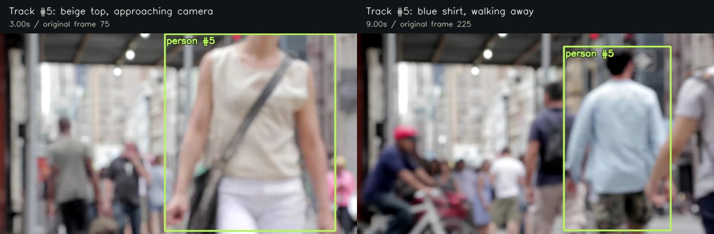

# Natural-motion evaluation: pedestrians on a city street

This adds a real recorded scene to the original controlled test. The purpose is to check whether the timeline remains useful when people move, overlap, approach the camera, and leave the frame.



## Source and reproducibility

- **Title:** Big City Life
- **Creator:** Coverr, 2015
- **Source page:** https://commons.wikimedia.org/wiki/File:Big_City_Life.webm
- **Original file:** https://upload.wikimedia.org/wikipedia/commons/2/2a/Big_City_Life.webm
- **License:** [CC0 1.0](https://creativecommons.org/publicdomain/zero/1.0/), recorded on the Wikimedia Commons file page; its license review is dated October 27, 2015. This attribution describes the specific archived file, not Coverr's current site-wide terms.
- **Original SHA-256:** `2834fbc411cc59f06a63f9ac7ce9ba5b748b67242d1b36a4b18043a070a7966a`
- **Transformation:** resize from 1920 x 1080 to 960 x 540, remove audio, encode H.264. All 356 frames are retained at 25 FPS, for 14.24 seconds. No synthetic motion or blank intervals were inserted. The source itself is visibly out of focus.
- **Scope:** one deliberately small qualitative case study. No training, fine-tuning, exhaustive person annotations, or accuracy benchmark.

The original, resized input, and inference results are included. Reproduce inference from the repository root:

```bash
python -m scenetrace examples/natural_motion/input.mp4 --classes person --stride 5 --output outputs/natural-motion
```

To rebuild the input from the verified original (requires FFmpeg):

```bash
python scripts/prepare_natural_demo.py
```

To regenerate the three paired panels from the saved report:

```bash
python scripts/build_motion_review.py
python scripts/verify_examples.py
```

## Observed run

| Measurement | Observed value |
| --- | --- |
| Source frames / analyzed frames | 356 / 72 |
| Analysis interval | 0.2 seconds |
| Maximum simultaneous person detections | 9 |
| Confirmed track starts | 26 |
| Missing-detection events | 19 |
| Initial relation observations | 92 |
| Changes to established relations | 3 |
| Total events | 140 |

These numbers describe software output. **26 track starts does not mean 26 distinct people**, and 140 events does not mean 140 correct statements. IDs can fragment or switch, and one pair can produce several observations. See the [complete timeline](result/SUMMARY.md), [JSON detections](result/report.json), and [annotated video](result/annotated.mp4).

## Three inspected cases

The following cases were selected after inspecting the output to explain behavior, not to estimate an unbiased success rate. The interpretation is qualitative; the panels and original video are available for independent review. The script reconstructs panels from actual video frames and saved bounding boxes without invoking the model again.

### 1. Useful missing-detection event: a foreground pedestrian exits

At 2.00s, the teal-shirted foreground pedestrian is visible at the right edge as track #1. At 2.80s, the system confirms that #1 has not been detected for three analyzed frames. The paired frames are consistent with that pedestrian leaving the view. The event time is the confirmation time, not a manually labeled exact exit time.



### 2. Useful spatial change: the order of two pedestrians reverses

At 4.00s, the box center of #6 is right of #9. By 5.00s, the ordering reverses, and the timeline records `person #6 left of person #9 (was right of)`. The frames show the dark-shirted foreground pedestrian moving right relative to the gray-shirted background pedestrian. This supports the reported two-dimensional relation; it does not establish a physical interaction or depth relation.



### 3. Failure: a track ID is reused for a different pedestrian

At 3.00s, #5 is assigned to a beige-shirted pedestrian approaching the camera. At 9.00s, the same ID labels a light-blue-shirted pedestrian walking away. Visual inspection shows that the identity is not consistent across these frames.



**Why this matters:** matching only class, box overlap, and center distance cannot reliably distinguish people during overlap and occlusion. A geometrically plausible match can still be the wrong person. The event log therefore cannot be interpreted as a reliable history of an individual. The evidence links make this error inspectable instead of hiding it behind a plausible timeline.

**Next improvement:** compare this baseline with a motion-aware tracker and, if necessary, appearance features. Evaluate on manually annotated person trajectories and report ID switches separately from detection quality. That improvement has not been implemented or validated in this submission.

## Connection to the project motivation

Video data review requires checking the evidence behind a claim, not only producing a clean-looking output. This case study makes that principle concrete: two observations are visually supported, while one identity failure limits how the timeline should be used. The natural-motion test complements the controlled blank-interval test; neither replaces a broader evaluation set.
