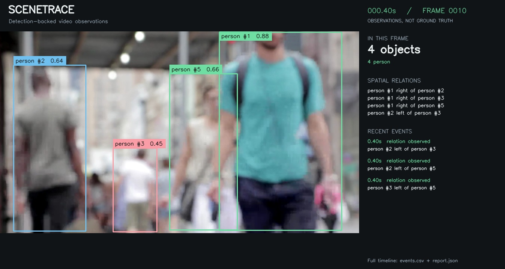

# SceneTrace run

Input: `input.mp4`

Analyzed **72 frames**, including **0 without detections**; logged **140 events**.

## Event timeline

- **0.20s** — person #1: detection confirmed ([evidence](evidence/frame_000005.jpg))
- **0.20s** — person #2: detection confirmed ([evidence](evidence/frame_000005.jpg))
- **0.20s** — person #3: detection confirmed ([evidence](evidence/frame_000005.jpg))
- **0.20s** — person #5: detection confirmed ([evidence](evidence/frame_000005.jpg))
- **0.40s** — person #1 right of person #2 ([evidence](evidence/frame_000010.jpg))
- **0.40s** — person #1 right of person #3 ([evidence](evidence/frame_000010.jpg))
- **0.40s** — person #1 right of person #5 ([evidence](evidence/frame_000010.jpg))
- **0.40s** — person #2 left of person #3 ([evidence](evidence/frame_000010.jpg))
- **0.40s** — person #2 left of person #5 ([evidence](evidence/frame_000010.jpg))
- **0.40s** — person #3 left of person #5 ([evidence](evidence/frame_000010.jpg))
- **0.80s** — person #6: detection confirmed ([evidence](evidence/frame_000020.jpg))
- **1.00s** — person #1 right of person #6 ([evidence](evidence/frame_000025.jpg))
- **1.00s** — person #2 left of person #6 ([evidence](evidence/frame_000025.jpg))
- **1.00s** — person #3 left of person #6 ([evidence](evidence/frame_000025.jpg))
- **1.00s** — person #5 right of person #6 ([evidence](evidence/frame_000025.jpg))
- **2.40s** — person #7: detection confirmed ([evidence](evidence/frame_000060.jpg))
- **2.60s** — person #8: detection confirmed ([evidence](evidence/frame_000065.jpg))
- **2.60s** — person #2 left of person #7 ([evidence](evidence/frame_000065.jpg))
- **2.60s** — person #3 left of person #7 ([evidence](evidence/frame_000065.jpg))
- **2.60s** — person #5 left of person #7 ([evidence](evidence/frame_000065.jpg))
- **2.80s** — person #1: not detected for 3 analyzed frames ([evidence](evidence/frame_000070.jpg))
- **2.80s** — person #9: detection confirmed ([evidence](evidence/frame_000070.jpg))
- **2.80s** — person #6 left of person #7 ([evidence](evidence/frame_000070.jpg))
- **3.00s** — person #2 left of person #9 ([evidence](evidence/frame_000075.jpg))
- **3.00s** — person #5 right of person #9 ([evidence](evidence/frame_000075.jpg))
- **3.00s** — person #6 right of person #9 ([evidence](evidence/frame_000075.jpg))
- **3.00s** — person #7 right of person #9 ([evidence](evidence/frame_000075.jpg))
- **3.20s** — person #8: not detected for 3 analyzed frames ([evidence](evidence/frame_000080.jpg))
- **3.20s** — person #3: not detected for 3 analyzed frames ([evidence](evidence/frame_000080.jpg))
- **3.60s** — person #7: not detected for 3 analyzed frames ([evidence](evidence/frame_000090.jpg))
- **4.00s** — person #10: detection confirmed ([evidence](evidence/frame_000100.jpg))
- **4.00s** — person #11: detection confirmed ([evidence](evidence/frame_000100.jpg))
- **4.00s** — person #13: detection confirmed ([evidence](evidence/frame_000100.jpg))
- **4.20s** — person #2 left of person #10 ([evidence](evidence/frame_000105.jpg))
- **4.20s** — person #2 left of person #11 ([evidence](evidence/frame_000105.jpg))
- **4.20s** — person #6 left of person #10 ([evidence](evidence/frame_000105.jpg))
- **4.20s** — person #6 left of person #11 ([evidence](evidence/frame_000105.jpg))
- **4.20s** — person #9 left of person #10 ([evidence](evidence/frame_000105.jpg))
- **4.20s** — person #9 left of person #11 ([evidence](evidence/frame_000105.jpg))
- **4.20s** — person #10 right of person #11 ([evidence](evidence/frame_000105.jpg))
- **4.40s** — person #5 right of person #10 ([evidence](evidence/frame_000110.jpg))
- **4.40s** — person #5 right of person #11 ([evidence](evidence/frame_000110.jpg))
- **4.60s** — person #13: not detected for 3 analyzed frames ([evidence](evidence/frame_000115.jpg))
- **5.00s** — person #6 left of person #9 (was right of) ([evidence](evidence/frame_000125.jpg))
- **5.20s** — person #14: detection confirmed ([evidence](evidence/frame_000130.jpg))
- **5.40s** — person #10: not detected for 3 analyzed frames ([evidence](evidence/frame_000135.jpg))
- **5.40s** — person #5 right of person #14 ([evidence](evidence/frame_000135.jpg))
- **5.40s** — person #6 right of person #14 ([evidence](evidence/frame_000135.jpg))
- **5.40s** — person #9 right of person #14 ([evidence](evidence/frame_000135.jpg))
- **5.40s** — person #11 right of person #14 ([evidence](evidence/frame_000135.jpg))
- **5.80s** — person #16: detection confirmed ([evidence](evidence/frame_000145.jpg))
- **6.00s** — person #15: detection confirmed ([evidence](evidence/frame_000150.jpg))
- **6.00s** — person #2 left of person #16 ([evidence](evidence/frame_000150.jpg))
- **6.00s** — person #5 right of person #16 ([evidence](evidence/frame_000150.jpg))
- **6.00s** — person #6 left of person #16 ([evidence](evidence/frame_000150.jpg))
- **6.00s** — person #9 right of person #16 ([evidence](evidence/frame_000150.jpg))
- **6.20s** — person #5 right of person #15 ([evidence](evidence/frame_000155.jpg))
- **6.20s** — person #6 right of person #15 ([evidence](evidence/frame_000155.jpg))
- **6.20s** — person #9 right of person #15 ([evidence](evidence/frame_000155.jpg))
- **6.20s** — person #15 left of person #16 ([evidence](evidence/frame_000155.jpg))
- **6.40s** — person #14 left of person #15 ([evidence](evidence/frame_000160.jpg))
- **6.40s** — person #14 left of person #16 ([evidence](evidence/frame_000160.jpg))
- **6.60s** — person #11: not detected for 3 analyzed frames ([evidence](evidence/frame_000165.jpg))
- **7.00s** — person #17: detection confirmed ([evidence](evidence/frame_000175.jpg))
- **7.00s** — person #18: detection confirmed ([evidence](evidence/frame_000175.jpg))
- **7.20s** — person #5 right of person #17 ([evidence](evidence/frame_000180.jpg))
- **7.20s** — person #5 right of person #18 ([evidence](evidence/frame_000180.jpg))
- **7.20s** — person #6 left of person #17 ([evidence](evidence/frame_000180.jpg))
- **7.20s** — person #6 right of person #18 ([evidence](evidence/frame_000180.jpg))
- **7.20s** — person #15 left of person #17 ([evidence](evidence/frame_000180.jpg))
- **7.20s** — person #16 left of person #17 ([evidence](evidence/frame_000180.jpg))
- **7.20s** — person #16 right of person #18 ([evidence](evidence/frame_000180.jpg))
- **7.20s** — person #17 right of person #18 ([evidence](evidence/frame_000180.jpg))
- **7.40s** — person #9: not detected for 3 analyzed frames ([evidence](evidence/frame_000185.jpg))
- **7.40s** — person #14: not detected for 3 analyzed frames ([evidence](evidence/frame_000185.jpg))
- **7.40s** — person #15 right of person #18 ([evidence](evidence/frame_000185.jpg))
- **8.20s** — person #2 left of person #15 ([evidence](evidence/frame_000205.jpg))
- **8.20s** — person #2 left of person #17 ([evidence](evidence/frame_000205.jpg))
- **8.20s** — person #2 aligned person #18 ([evidence](evidence/frame_000205.jpg))
- **8.60s** — person #19: detection confirmed ([evidence](evidence/frame_000215.jpg))
- **8.60s** — person #21: detection confirmed ([evidence](evidence/frame_000215.jpg))
- **8.80s** — person #16: not detected for 3 analyzed frames ([evidence](evidence/frame_000220.jpg))
- **8.80s** — person #5 right of person #19 ([evidence](evidence/frame_000220.jpg))
- **8.80s** — person #6 right of person #19 ([evidence](evidence/frame_000220.jpg))
- **8.80s** — person #17 right of person #19 ([evidence](evidence/frame_000220.jpg))
- **9.00s** — person #20: detection confirmed ([evidence](evidence/frame_000225.jpg))
- **9.20s** — person #18: not detected for 3 analyzed frames ([evidence](evidence/frame_000230.jpg))
- **9.20s** — person #5 left of person #20 ([evidence](evidence/frame_000230.jpg))
- **9.20s** — person #17 left of person #20 ([evidence](evidence/frame_000230.jpg))
- **9.60s** — person #2 left of person #20 ([evidence](evidence/frame_000240.jpg))
- **9.80s** — person #22: detection confirmed ([evidence](evidence/frame_000245.jpg))
- **9.80s** — person #5 right of person #21 ([evidence](evidence/frame_000245.jpg))
- **9.80s** — person #15 left of person #21 ([evidence](evidence/frame_000245.jpg))
- **9.80s** — person #17 right of person #21 ([evidence](evidence/frame_000245.jpg))
- **9.80s** — person #19 aligned person #21 ([evidence](evidence/frame_000245.jpg))
- **10.00s** — person #6: not detected for 3 analyzed frames ([evidence](evidence/frame_000250.jpg))
- **10.00s** — person #5 right of person #22 ([evidence](evidence/frame_000250.jpg))
- **10.00s** — person #15 left of person #19 ([evidence](evidence/frame_000250.jpg))
- **10.00s** — person #15 right of person #22 ([evidence](evidence/frame_000250.jpg))
- **10.00s** — person #17 right of person #22 ([evidence](evidence/frame_000250.jpg))
- **10.00s** — person #19 right of person #22 ([evidence](evidence/frame_000250.jpg))
- **10.00s** — person #21 right of person #22 ([evidence](evidence/frame_000250.jpg))
- **10.20s** — person #2 left of person #19 ([evidence](evidence/frame_000255.jpg))
- **10.20s** — person #2 left of person #21 ([evidence](evidence/frame_000255.jpg))
- **10.20s** — person #2 left of person #22 ([evidence](evidence/frame_000255.jpg))
- **10.60s** — person #23: detection confirmed ([evidence](evidence/frame_000265.jpg))
- **10.80s** — person #20: not detected for 3 analyzed frames ([evidence](evidence/frame_000270.jpg))
- **10.80s** — person #21: not detected for 3 analyzed frames ([evidence](evidence/frame_000270.jpg))
- **10.80s** — person #15: not detected for 3 analyzed frames ([evidence](evidence/frame_000270.jpg))
- **11.20s** — person #23: not detected for 3 analyzed frames ([evidence](evidence/frame_000280.jpg))
- **11.20s** — person #24: detection confirmed ([evidence](evidence/frame_000280.jpg))
- **11.40s** — person #26: detection confirmed ([evidence](evidence/frame_000285.jpg))
- **11.40s** — person #5 right of person #24 ([evidence](evidence/frame_000285.jpg))
- **11.40s** — person #17 right of person #24 ([evidence](evidence/frame_000285.jpg))
- **11.40s** — person #19 right of person #24 ([evidence](evidence/frame_000285.jpg))
- **11.80s** — person #2: not detected for 3 analyzed frames ([evidence](evidence/frame_000295.jpg))
- **11.80s** — person #25: detection confirmed ([evidence](evidence/frame_000295.jpg))
- **12.00s** — person #26: not detected for 3 analyzed frames ([evidence](evidence/frame_000300.jpg))
- **12.00s** — person #5 right of person #25 ([evidence](evidence/frame_000300.jpg))
- **12.00s** — person #17 right of person #25 ([evidence](evidence/frame_000300.jpg))
- **12.00s** — person #19 left of person #25 ([evidence](evidence/frame_000300.jpg))
- **12.00s** — person #22 left of person #25 ([evidence](evidence/frame_000300.jpg))
- **12.20s** — person #28: detection confirmed ([evidence](evidence/frame_000305.jpg))
- **12.20s** — person #22 right of person #24 ([evidence](evidence/frame_000305.jpg))
- **12.20s** — person #24 left of person #25 ([evidence](evidence/frame_000305.jpg))
- **12.40s** — person #5 right of person #28 ([evidence](evidence/frame_000310.jpg))
- **12.40s** — person #17 right of person #28 ([evidence](evidence/frame_000310.jpg))
- **12.40s** — person #19 left of person #28 ([evidence](evidence/frame_000310.jpg))
- **12.40s** — person #22 left of person #28 ([evidence](evidence/frame_000310.jpg))
- **12.40s** — person #24 left of person #28 ([evidence](evidence/frame_000310.jpg))
- **12.40s** — person #25 left of person #28 ([evidence](evidence/frame_000310.jpg))
- **13.20s** — person #30: detection confirmed ([evidence](evidence/frame_000330.jpg))
- **13.40s** — person #5 right of person #30 ([evidence](evidence/frame_000335.jpg))
- **13.40s** — person #17 right of person #30 ([evidence](evidence/frame_000335.jpg))
- **13.40s** — person #19 right of person #30 ([evidence](evidence/frame_000335.jpg))
- **13.40s** — person #25 aligned person #28 (was left of) ([evidence](evidence/frame_000335.jpg))
- **13.40s** — person #25 right of person #30 ([evidence](evidence/frame_000335.jpg))
- **13.40s** — person #28 right of person #30 ([evidence](evidence/frame_000335.jpg))
- **13.60s** — person #22: not detected for 3 analyzed frames ([evidence](evidence/frame_000340.jpg))
- **13.80s** — person #25 left of person #28 (was aligned) ([evidence](evidence/frame_000345.jpg))

Events reflect model observations, not verified scene changes. End of file does not imply that visible objects disappeared.
