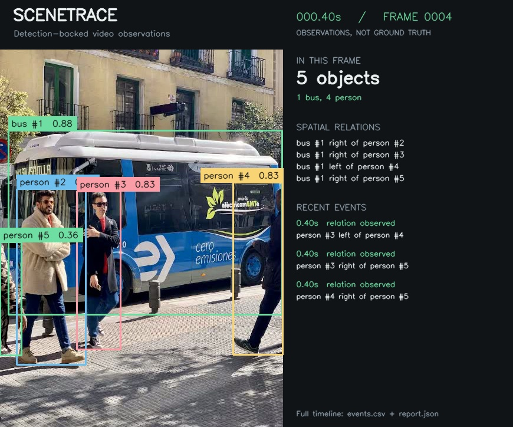

# SceneTrace run

Input: `controlled_clip.mp4`

Analyzed **40 frames**, including **10 without detections**; logged **36 events**.

## Event timeline

- **0.20s** — bus #1: detection confirmed ([evidence](evidence/frame_000002.jpg))
- **0.20s** — person #2: detection confirmed ([evidence](evidence/frame_000002.jpg))
- **0.20s** — person #3: detection confirmed ([evidence](evidence/frame_000002.jpg))
- **0.20s** — person #4: detection confirmed ([evidence](evidence/frame_000002.jpg))
- **0.20s** — person #5: detection confirmed ([evidence](evidence/frame_000002.jpg))
- **0.40s** — bus #1 right of person #2 ([evidence](evidence/frame_000004.jpg))
- **0.40s** — bus #1 right of person #3 ([evidence](evidence/frame_000004.jpg))
- **0.40s** — bus #1 left of person #4 ([evidence](evidence/frame_000004.jpg))
- **0.40s** — bus #1 right of person #5 ([evidence](evidence/frame_000004.jpg))
- **0.40s** — person #2 left of person #3 ([evidence](evidence/frame_000004.jpg))
- **0.40s** — person #2 left of person #4 ([evidence](evidence/frame_000004.jpg))
- **0.40s** — person #2 right of person #5 ([evidence](evidence/frame_000004.jpg))
- **0.40s** — person #3 left of person #4 ([evidence](evidence/frame_000004.jpg))
- **0.40s** — person #3 right of person #5 ([evidence](evidence/frame_000004.jpg))
- **0.40s** — person #4 right of person #5 ([evidence](evidence/frame_000004.jpg))
- **1.60s** — person #5: not detected for 3 analyzed frames ([evidence](evidence/frame_000016.jpg))
- **3.20s** — person #6: detection confirmed ([evidence](evidence/frame_000032.jpg))
- **3.40s** — bus #1 right of person #6 ([evidence](evidence/frame_000034.jpg))
- **3.40s** — person #2 right of person #6 ([evidence](evidence/frame_000034.jpg))
- **3.40s** — person #3 right of person #6 ([evidence](evidence/frame_000034.jpg))
- **3.40s** — person #4 right of person #6 ([evidence](evidence/frame_000034.jpg))
- **4.20s** — person #4: not detected for 3 analyzed frames ([evidence](evidence/frame_000042.jpg))
- **4.40s** — bus #1: not detected for 3 analyzed frames ([evidence](evidence/frame_000044.jpg))
- **4.40s** — person #2: not detected for 3 analyzed frames ([evidence](evidence/frame_000044.jpg))
- **4.40s** — person #3: not detected for 3 analyzed frames ([evidence](evidence/frame_000044.jpg))
- **4.40s** — person #6: not detected for 3 analyzed frames ([evidence](evidence/frame_000044.jpg))
- **6.20s** — bus #7: detection confirmed ([evidence](evidence/frame_000062.jpg))
- **6.20s** — person #8: detection confirmed ([evidence](evidence/frame_000062.jpg))
- **6.20s** — person #9: detection confirmed ([evidence](evidence/frame_000062.jpg))
- **6.20s** — person #10: detection confirmed ([evidence](evidence/frame_000062.jpg))
- **6.40s** — bus #7 right of person #8 ([evidence](evidence/frame_000064.jpg))
- **6.40s** — bus #7 left of person #9 ([evidence](evidence/frame_000064.jpg))
- **6.40s** — bus #7 right of person #10 ([evidence](evidence/frame_000064.jpg))
- **6.40s** — person #8 left of person #9 ([evidence](evidence/frame_000064.jpg))
- **6.40s** — person #8 left of person #10 ([evidence](evidence/frame_000064.jpg))
- **6.40s** — person #9 right of person #10 ([evidence](evidence/frame_000064.jpg))

Events reflect model observations, not verified scene changes. End of file does not imply that visible objects disappeared.
